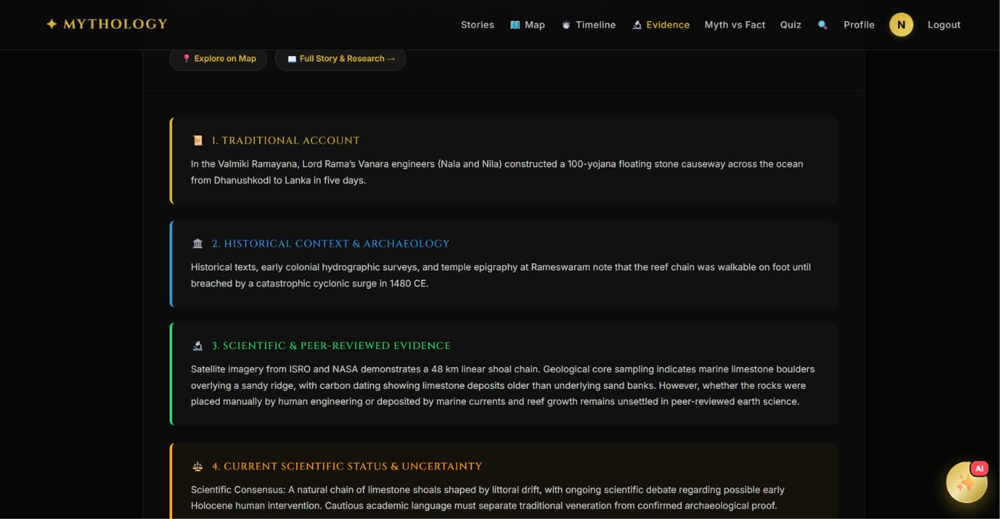
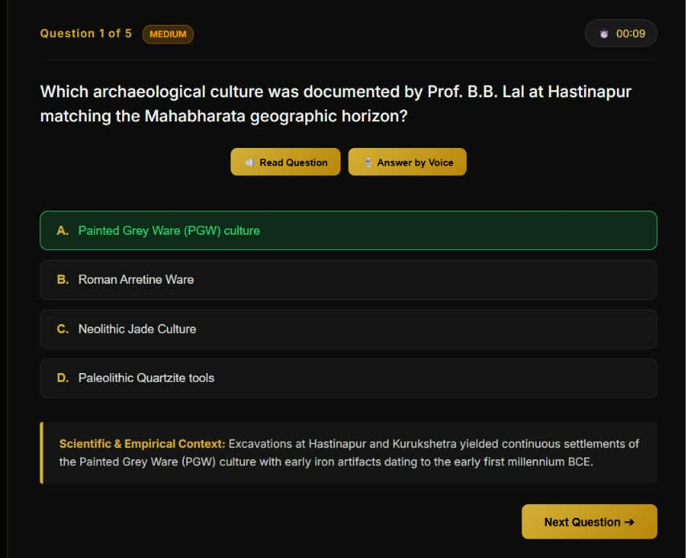
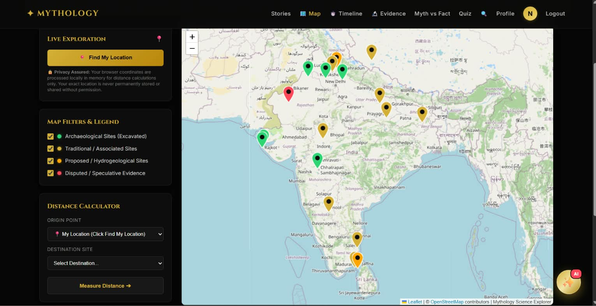
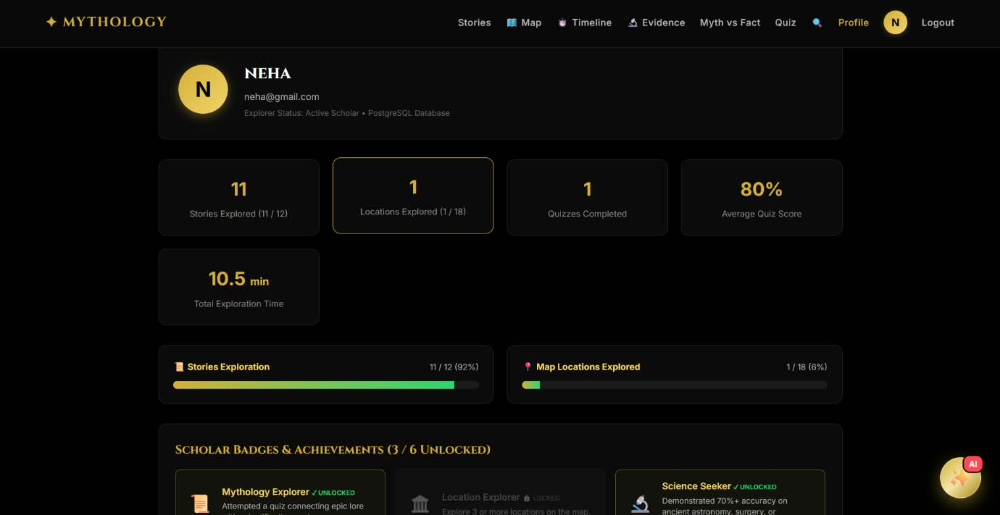
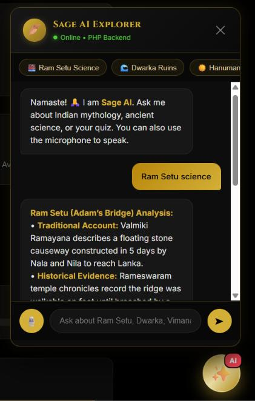
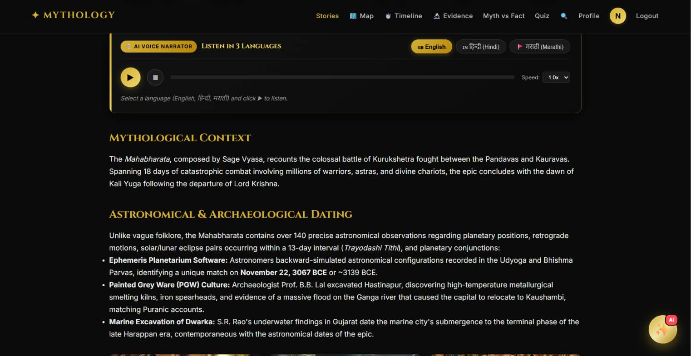

# ✦ Mythology Science Knowledge Explore (Pure PHP Backend)

A PHP web application exploring connections between **ancient Indian mythology, history, archaeology, and science**. It includes story pages, an evidence/map interface, quizzes, a reading tracker, user profiles, and a rule-based knowledge assistant.

> **Research note:** Mythological traditions, historical interpretations, and scientific findings are not the same kind of evidence. Treat specific dates, measurements, and proposed connections as claims to verify against reliable primary or scholarly sources; do not present a proposed interpretation as established scientific consensus.

---

## 🌟 Key Features

1. **Ancient Stories Deep-Dive (12 In-Depth Topics)**:
   - *Ram Setu (`ramseturead.php`)*: Satellite imagery, carbon dating of coral limestone rocks vs sandbanks.
   - *Mahabharata (`mahabharatread.php`)*: Astronomical dating (3067 BCE), planetary retrogrades, and Hastinapur excavations.
   - *The Lost City of Dwarka (`dwarkaread.php`)*: Submerged sandstone ruins and 3-hole Bronze Age anchors found by NIO.
   - *Kailasa Temple at Ellora (`kailasaread.php`)*: World's largest top-down monolithic rock excavation (200,000 tons of basalt).
   - *Surya Siddhanta & Vedic Astronomy (`suryaread.php`)*: Sidereal year calculation (within 1.4s), speed of light formula.
   - *Hanuman & The Sun (`hamunaread.php`)*: Mathematical decoding of the *Yug Sahastra Yojan* distance in the Hanuman Chalisa (~149.6M km).
   - *Vimanas & Ancient Aeronautics (`vimansread.php`)*: Sanskrit flight treatises, mercury vortex principles, and ancient metallurgy.
   - *Sushruta: Father of Surgery (`ayurvedaread.php`)*: Ancient forehead flap rhinoplasty, cataract couching, and 121 surgical tools.
   - *Nataraja & Cosmic Particles (`natarajaread.php`)*: Quantum field theory and the 2-meter bronze statue at CERN in Geneva.
   - *Brahmastra & Ancient Ballistics (`brahmastraread.php`)*: Descriptions of thermal radiation, ionizing fallout, and Dr. Oppenheimer's reflections.
   - *The Lost Saraswati River (`saraswatiread.php`)*: ISRO radar mapping of subterranean paleochannels beneath the Thar Desert.
   - *Samudra Manthan (`samudramanthan.php`)*: The cosmological churning of primordial matter and planetary differentiation.

2. **🎯 Interactive Quiz & Score Analytics (`quiz.php`)**:
   - Multiple categories: Ramayana, Mahabharata, Astronomy, Architecture, and Bio-Science.
   - Instant scientific explanations for every question.
   - Real-time Score & Accuracy breakdown, time tracking, and earnable Scholar Badges (🏆 Grand Scholar, 📜 Knowledge Seeker).
   - Performance history and analytics logged to the User Profile database via `api/quiz.php`.

3. **✨ 24/7 Intelligent Sage AI Chatbot (`api/chat.php`)**:
   - Floating widget accessible across all pages with gold/dark theme.
   - Answers questions about ancient epics, archaeological evidence, scientific parallels, and site navigation.
   - Powered by a PHP knowledge graph API.

4. **✨ 3D Myth vs Fact Flip-Cards (`myth-fact.php`)**:
   - Interactive flip-cards with category filters exploring topics like 432 Hz temple bells, copper vessel purification, solar eclipse UV shifts, and the rust-resistant Iron Pillar of Delhi.

5. **⏱️ Automatic Reading Activity Tracker (`api/track.php`)**:
   - Client-side timer (`track.js`) that automatically logs seconds spent exploring each story and dynamically updates progress in the User Profile dashboard.

6. **👤 User Dashboard & Profile (`profile.php`)**:
   - Total stories explored, reading time (seconds/minutes), quizzes attempted, average accuracy, and earned scholar badges.

---

## 🚀 How to Run with PHP

### Method 1: Using PHP Built-in Server (Easiest)

Since you have XAMPP installed at `C:\xampp\php\`, you can start the server directly from this folder:

```powershell
& "C:\xampp\php\php.exe" -S localhost:8000
```

Then open your browser and go to:
👉 **`http://localhost:8000`**

*(If PHP is added to your system PATH, you can simply run: `php -S localhost:8000`)*

---

### Method 2: Running in XAMPP (Apache only)

1. Copy or move this project folder to your XAMPP `htdocs` directory:
   ```
   C:\xampp\htdocs\mini_project\
   ```
2. Open the **XAMPP Control Panel** and start **Apache**. PostgreSQL must be running separately.
3. (Optional) Open **phpMyAdmin** (`http://localhost/phpmyadmin`) and import `database/schema_mysql.sql`.
   *(Note: `config/db.php` will automatically create the database and tables for you if they don't already exist!)*
4. Open your browser and navigate to:
   👉 **`http://localhost/mini_project/`**

---

## 🧪 Verification

Use the end-to-end checklist in `README_PHP_SETUP.md`: create an account, confirm it appears in PostgreSQL, log in, take a quiz, and confirm `quiz_results`/`badges` are saved for the same `user_id`.

## 🗄️ Database Architecture

- **`users`**: User credentials with secure BCrypt password hashing.
- **`user_activity`**: Reading time and content interactions.
- **`quiz_results`**: Topic scores, accuracy percentage, time taken, and completion timestamps.
- **`badges`**: Unlocked achievements and scholar awards.

---

## 🛡️ Security
- **BCrypt Password Hashing**: Passwords are securely hashed with `password_hash($pwd, PASSWORD_BCRYPT)`.
- **PDO Prepared Statements**: 100% protection against SQL injection across all queries.
- **Session Protection**: Native PHP session management (`session_start()`).

## 🎙️ Voice Assistant

The quiz and Sage AI chatbot include browser-based voice features using the Web Speech API. No paid voice API or Python service is required. Chrome/Edge generally provide the best support.

---

## 📸 Screenshots

Explore the main features of the Mythology Science Knowledge Explorer.

### 🏠 Homepage


### 📚 Mythology Explorer



### 🧠 Interactive Quiz



### 🗺️ Evidence & Map



### 👤 User Dashboard



### 🤖 Sage AI Knowledge Assistant



### 📖 Story Page



### 🔐 Login Page


## GitHub publication checklist

- Do not commit real passwords, API keys, personal data, database dumps, or production credentials.
- The database password is read from the `DB_PASS` environment variable. Set it locally before running the app if your PostgreSQL account requires a password.
- This repository package excludes the old `backup/` folder to avoid publishing duplicate legacy code.
- Before deploying publicly, review authentication, password reset, input validation, session security, and error handling.

## Database environment variables

The app supports `DB_HOST`, `DB_PORT`, `DB_NAME`, `DB_USER`, and `DB_PASS`. For example, configure these in your local terminal or hosting environment rather than hard-coding credentials in PHP.
